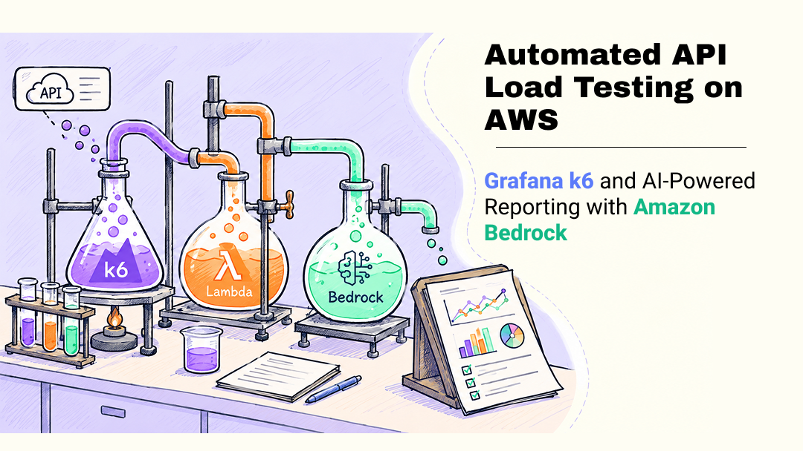
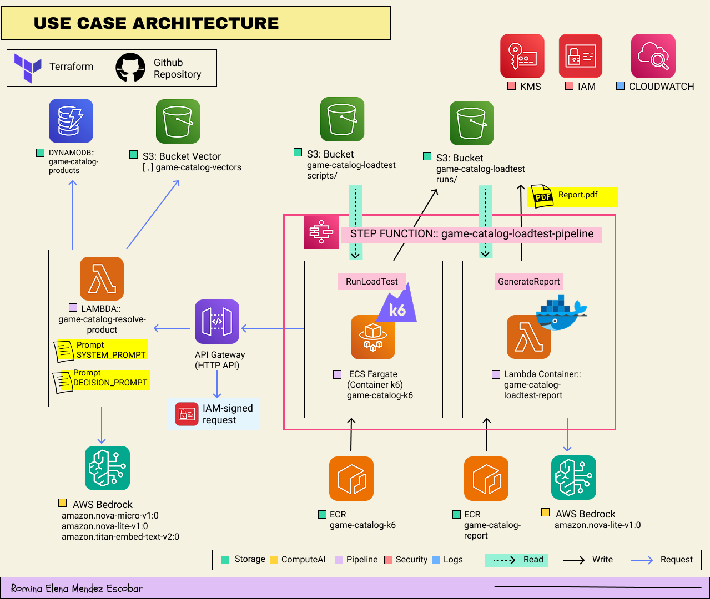

# ⚡ Automated API Load Testing on AWS: Grafana k6 and AI-Powered Reporting with Amazon Bedrock

Serverless pipeline that runs **Grafana k6** load tests against an API on **Amazon ECS Fargate**,
orchestrated by **AWS Step Functions**, and generates a **PDF report** where **Amazon Bedrock**
interprets the metrics. All the infrastructure is defined with **Terraform**.



📝 **Article:** _<link to the article>_
🔗 **Part 1 (the API under test):** [Identical or Similar? AI-Powered Product Matching with Amazon Bedrock and S3 Vectors](https://dev.to/aws-builders/identical-or-similar-ai-powered-product-matching-with-amazon-bedrock-and-s3-vectors-3pm) · [repository](https://github.com/RominaElenaMendezEscobar/aws-games-products)

---

## 🎯 What it does

1. **Runs a load test** with k6 in a container on ECS Fargate, using a configurable scenario (smoke, load, stress, spike).
2. **Stores every run** in its own S3 folder, with the results and an exact copy of the scenario used.
3. **Generates a PDF report**: metrics are computed by code; Amazon Bedrock only interprets them, and the figures it quotes are validated against the computed metrics.

The thresholds of each scenario work as **SLOs**: the report shows whether they were met.

## 🏗️ Architecture



| Component | Service | Role |
|---|---|---|
| API under test | Amazon API Gateway (HTTP API) + AWS Lambda | Search API from part 1, protected with IAM authorization |
| Orchestration | AWS Step Functions | `PrepareRun` → `RunLoadTest` → `GenerateReport` |
| Load generator | Amazon ECS Fargate + Grafana k6 | Runs the scenario and signs every request (AWS SigV4) |
| Report | AWS Lambda (container image) + Amazon Bedrock | Computes metrics, charts and the PDF; Nova Pro interprets the results |
| Storage | Amazon S3 | Scripts (`scripts/`) and results of every run (`runs/`) |
| Images | Amazon ECR | `game-catalog-k6` and `game-catalog-report` |
| Infrastructure | Terraform | Everything above, except the API under test |

## 📁 Repository structure

```
game-catalog-k6/
├── Dockerfile, entrypoint.sh   → k6 image that runs on Fargate
├── search.js, sigv4.js         → test script and IAM request signing
├── scenarios/                  → one JSON file per test type
├── queries.json                → requests sent to the API
├── report/                     → report Lambda (Python, container image)
│   └── config/                 → styles, metric glossary and Bedrock model
├── terraform/                  → infrastructure
└── build-and-push.sh           → builds the images and pushes them to ECR
```

## ✅ Prerequisites

- An AWS account with access to **Amazon Bedrock** (`amazon.nova-pro-v1:0`) in `us-east-1`.
- An **HTTP API in API Gateway with IAM authorization** to test (in this project, the search API from part 1).
- **AWS CloudShell** (recommended: it already has the AWS CLI, Docker and credentials) or a machine with Terraform ≥ 1.6, AWS CLI v2 and Docker.

## 🚀 Quick start (AWS CloudShell)

**1. Install Terraform** (only the first time):

```bash
curl -sLo /tmp/terraform.zip https://releases.hashicorp.com/terraform/1.9.8/terraform_1.9.8_linux_amd64.zip
mkdir -p ~/bin && unzip -o /tmp/terraform.zip -d ~/bin
echo 'export PATH=$HOME/bin:$PATH' >> ~/.bashrc && source ~/.bashrc
terraform version
```

**2. Deploy:**

```bash
git clone https://github.com/RominaElenaMendezEscobar/game-catalog-k6.git
cd game-catalog-k6/terraform
echo 'api_id = "<api-id>"' > terraform.tfvars

terraform init
terraform apply -target=aws_ecr_repository.k6 -target=aws_ecr_repository.report   # 1. ECR repositories
../build-and-push.sh                                                               # 2. images
terraform apply                                                                    # 3. everything else
```

The report Lambda is created from a container image, so the image must exist before the function:
that is why the first deployment has three steps.

**3. Run a load test:**

```bash
aws stepfunctions start-execution \
  --state-machine-arn "$(terraform output -raw state_machine_arn)" \
  --input '{"scenario": "smoke", "label": "baseline"}'
```

The report is saved in `s3://game-catalog-loadtest/runs/<scenario>/<run_id>/report.pdf`.

> ⚠️ Terraform keeps its state in `terraform/terraform.tfstate`. Update the repository with `git pull` and
> don't delete that folder, or Terraform won't be able to update or destroy the resources.

## 🔧 Use it with your own API

The k6 code, the infrastructure and the report generator don't depend on this API. To test another one, change:

| What | Where | Notes |
|---|---|---|
| **The API** | `terraform/terraform.tfvars` → `api_id` | The ID in `https://<api-id>.execute-api.<region>.amazonaws.com`. Terraform grants the k6 task permission to call only that API. |
| **The requests** | `queries.json` | k6 picks one at random on each request. `lang` is only used to split the results in the report. If your API expects another body, adapt it in `search.js`. |
| **The load** | `scenarios/*.json` | Virtual users, duration, load pattern and thresholds (SLOs). Copy a file to create a new scenario and run it with `{"scenario": "<file name>"}`. |
| **The report** | `report/config/*.yaml` | `style.yaml` (colors, fonts), `metrics.yaml` (glossary and chart texts), `report.yaml` (Bedrock model). |

### Scenarios included

| Scenario | Load | Purpose | Thresholds |
|---|---|---|---|
| `smoke` | 1 user for 1 min | Check that everything works | errors < 1% · p95 < 5 s |
| `load` | 5 users for 5 min | Normal, steady load | errors < 5% · p95 < 5 s |
| `stress` | ramp from 5 to 40 users in 6 min | Find where it degrades | errors < 5% · p95 < 8 s |
| `spike` | 0 → 50 users in 30 s, held 1 min | Sudden traffic peak | errors < 10% · p95 < 10 s |

Example (`scenarios/smoke.json`):

```json
{
  "name": "smoke",
  "description": "1 user for 1 minute: checks that the API works before adding load.",
  "queries_file": "queries.json",
  "endpoint": "/search",
  "think_time_seconds": 1,
  "executor": { "executor": "constant-vus", "vus": 1, "duration": "1m" },
  "thresholds": {
    "http_req_failed": ["rate<0.01"],
    "http_req_duration": ["p(95)<5000"]
  }
}
```

## 📦 What every run produces

`s3://game-catalog-loadtest/runs/<scenario>/<YYYY-MM-DD--HH-MM-SS>/`

| File | Created by | Content |
|---|---|---|
| `k6-summary.json` | k6 | Aggregated metrics and threshold results |
| `k6-results.csv` | k6 | One row per request and metric (used for charts over time) |
| `run-info.json` | k6 container | Scenario, label, dates, k6 version and container image |
| `scripts/` | k6 container | Exact copy of the scripts and scenarios used |
| `metrics.json` | Report Lambda | Metrics computed by code |
| `ai-analysis.json` | Report Lambda | Bedrock interpretation and validation of its figures |
| `report.pdf` | Report Lambda | Final report |

📄 **Example report:** [`output/.../report.pdf`](output/s3/game-catalog-loadtest/runs/smoke/2026-10-23--22-44-20/report.pdf)

## 🔄 Day-to-day changes

| Change | Run |
|---|---|
| Scenarios, `queries.json` or `search.js` | `terraform apply` (uploads the scripts to S3 again) |
| `Dockerfile` or `entrypoint.sh` | `./build-and-push.sh k6` |
| Report code or `report/config/*.yaml` | `./build-and-push.sh report` (also updates the Lambda) |
| Any `.tf` file | `terraform apply` |

## 🔐 Security

- The API only accepts **IAM-signed requests** (AWS SigV4); only the k6 task role can invoke it.
- The k6 task runs in a **public subnet with a security group with no inbound rules** and HTTPS-only outbound, and only exists while the test runs. For production, consider private subnets with VPC endpoints.
- **One least-privilege IAM role per component** (k6 task, report Lambda, Step Functions).
- No secrets stored: credentials are temporary and rotated by AWS. `terraform.tfvars` and the Terraform state are excluded from Git.

## 💰 Cost

Each search calls Amazon Bedrock, so the cost grows with the number of requests. As an estimate with public
prices in `us-east-1`, a full round of the four scenarios (~3,000–4,000 requests) costs **under 1 USD**,
plus a few cents of Fargate. Check the actual cost in AWS Cost Explorer, and set an **AWS Budgets** alert.

## 🧹 Clean up

```bash
cd terraform
terraform destroy
```

The bucket and the ECR repositories are only deleted if they are empty. To delete them with their content,
add `force_destroy = true` to `terraform.tfvars`, run `terraform apply` and then `terraform destroy`.

## ⚠️ Limitations

- Tests run from a **single AWS region**.
- Short scenarios produce **small samples**: p95 and p99 can vary a lot between runs.
- The AI analysis depends on the **model and the prompt**; its figures are validated, but the tables and charts are the source of truth.
- Not yet integrated in **CI/CD**, and runs are not compared automatically.

## 📚 References

- Beyer, B., Jones, C., Petoff, J. & Murphy, N. R. (2016). *Site Reliability Engineering: How Google Runs Production Systems*. O'Reilly. https://sre.google/sre-book/table-of-contents/
- Grafana Labs. *Grafana k6*. https://grafana.com/oss/k6/
- Grafana Labs. *Load test types*. https://grafana.com/docs/k6/latest/testing-guides/test-types/
- Amazon Web Services. *Lambda quotas*. https://docs.aws.amazon.com/lambda/latest/dg/gettingstarted-limits.html

## 👩‍💻 Author

**Romina Elena Mendez Escobar** · AWS Community Builder